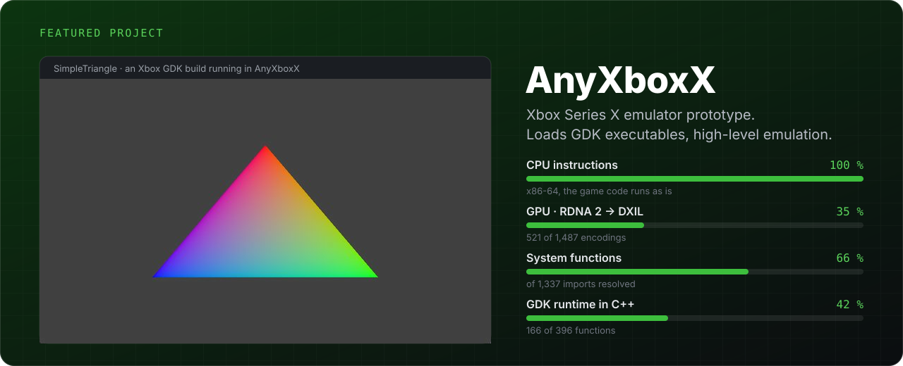
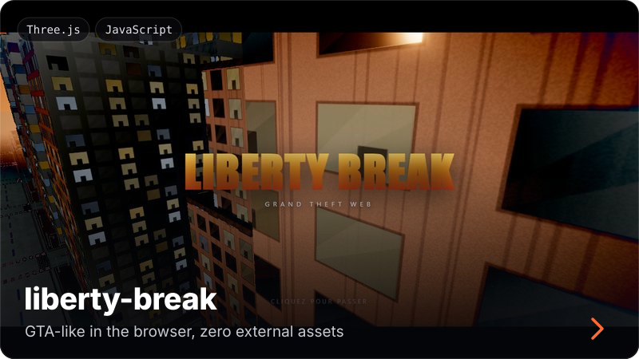
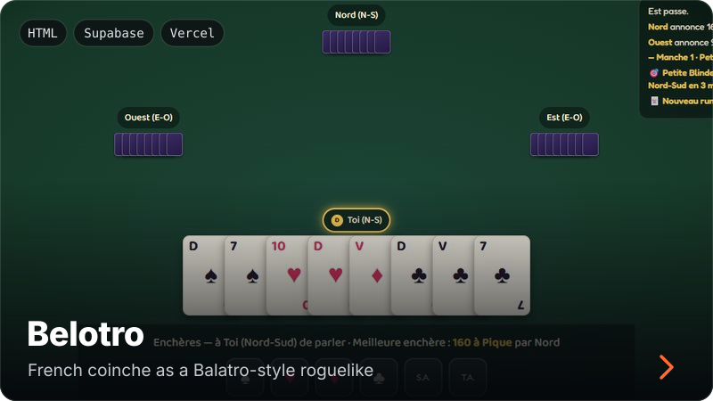
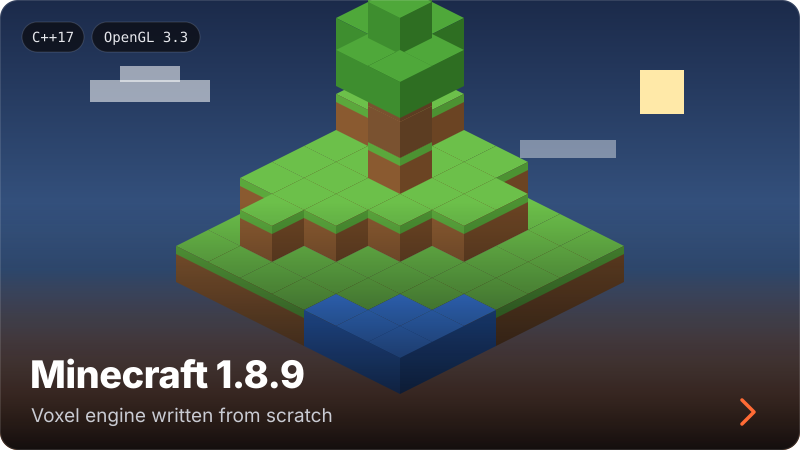
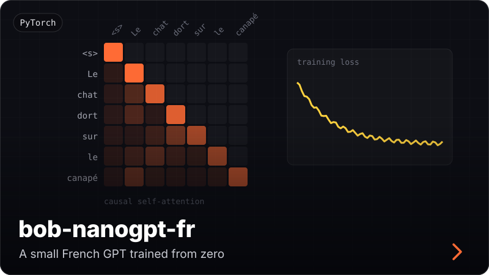
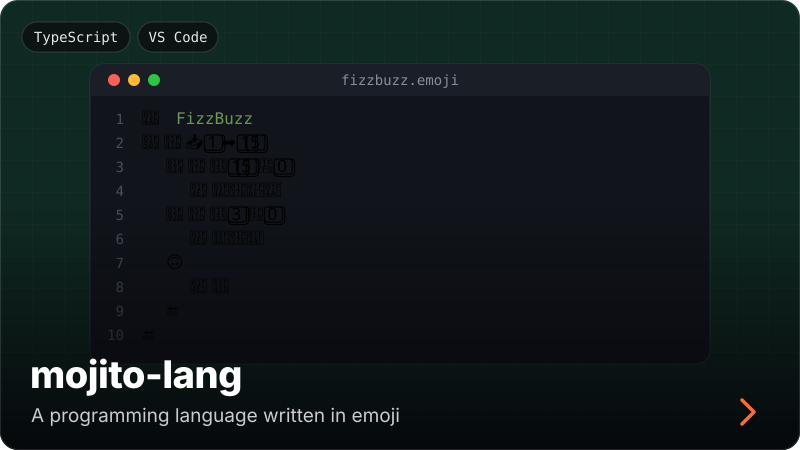
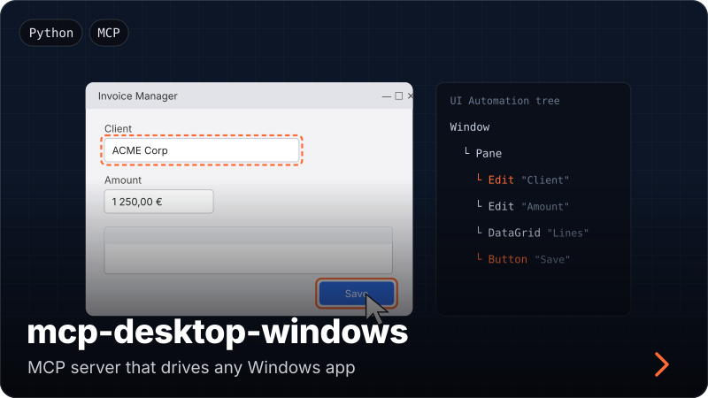
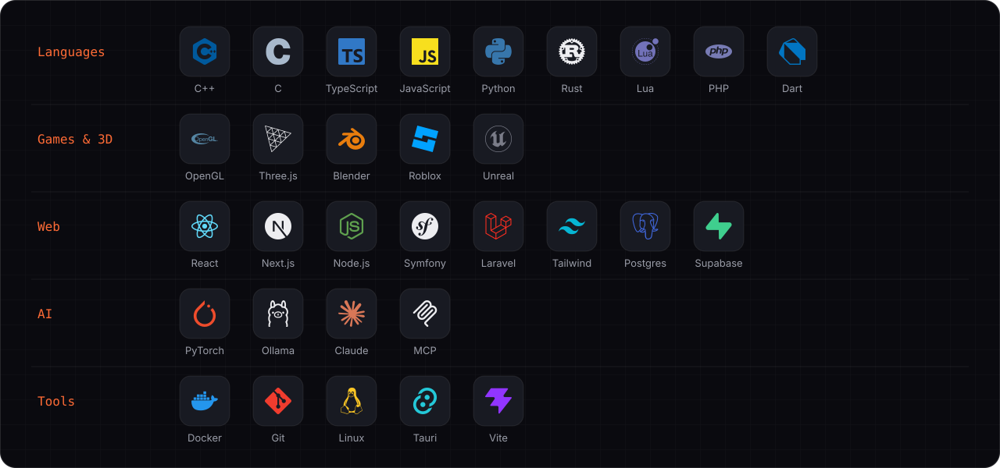

<picture>
  <source media="(prefers-color-scheme: dark)" srcset="assets/header-dark.svg">
  <source media="(prefers-color-scheme: light)" srcset="assets/header-light.svg">
  
</picture>

  Developer based in France. I rebuild hard things from scratch to understand how they work: 
  a Minecraft engine in C++, an Xbox Series X emulator, a GPT trained from zero, a language made of emoji.

  

 

## 🎮 Right now

## 🧱 Projects

  
  
  
  
  
  

<b>More projects</b>

 

| Project | What it is | Stack |
| --- | --- | --- |
| [nexagen](https://github.com/LooperSalty/nexagen) | Procedural world engine playable in the browser, with AI-assisted generation | TypeScript, Three.js |
| [jarvis](https://github.com/LooperSalty/jarvis) | Local voice assistant on Ollama: Three.js orb, Obsidian memory, desktop actions | Python |
| [jobbot](https://github.com/LooperSalty/jobbot) | Job-search autopilot: collects offers, scores them, writes a tailored CV and letter, follows up | Python |
| [montage-video-claude](https://github.com/LooperSalty/montage-video-claude) | Video editing driven by Claude Code: skills, MCP servers, TikTok production kit | Python |
| [claude-code-config](https://github.com/LooperSalty/claude-code-config) | My Claude Code setup: agents, hooks, rules, slash commands | JavaScript |
| [cs2-tracker](https://github.com/LooperSalty/cs2-tracker) | Counter-Strike 2 stats: live match tracking, in-game overlay, heuristic anti-cheat | Python |
| [WallpaperEngine](https://github.com/LooperSalty/WallpaperEngine) | GTK4 / libadwaita app to browse and apply Wallpaper Engine wallpapers on Linux | Python |

## 🛠️ Stack

Icons from <a href="https://simpleicons.org">Simple Icons</a> (CC0). Screenshots taken from the projects themselves.
